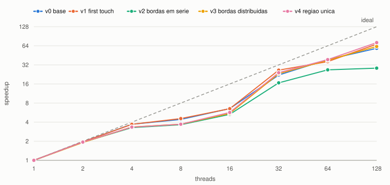
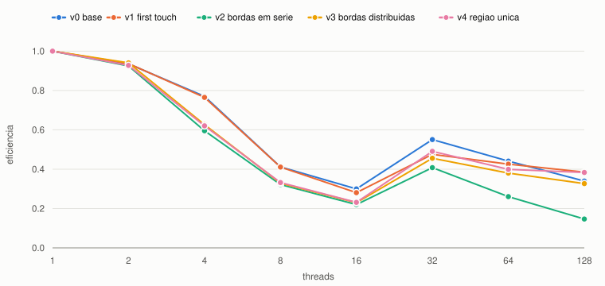
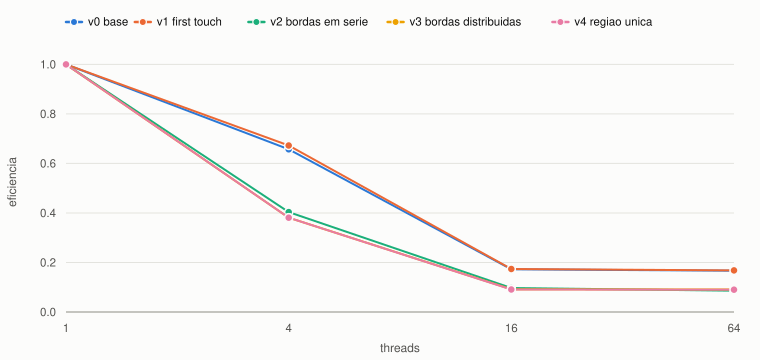

# Escalabilidade do código de Navier-Stokes no NPAD

## O que foi feito

Peguei o código da Tarefa 11 (difusão viscosa, malha `n × n`, bordas periódicas)
e medi a escalabilidade **forte** e **fraca** num nó do NPAD. Depois procurei os
gargalos e ataquei um por vez, em cinco versões.

**Resultado:** a melhor versão ficou **90× mais rápida** que o sequencial original,
mas o programa **não é fortemente nem fracamente escalável**. O gargalo principal
é a **memória**: cache e banda.

## Conceitos

| termo | definição |
|---|---|
| desempenho | rapidez: 1 / tempo |
| eficiência | aproveitamento dos recursos: trabalho / (tempo × recursos) |
| speedup | S(p) = T(1) / T(p) |
| eficiência paralela | E(p) = S(p) / p — o ideal é 1 |
| escalável | dá para recuperar a eficiência **aumentando o problema** |
| fracamente escalável | mantém a eficiência quando o problema cresce **junto** com os recursos |
| fortemente escalável | mantém a eficiência **sem** aumentar o problema |

Os conjuntos ficam um dentro do outro: **forte ⊂ fraca ⊂ escalável**. Quem mantém
a eficiência sem crescer o problema também mantém quando ele cresce.

> **Como eu explico:** desempenho é rapidez, não importa se estou desperdiçando recurso.
Eficiência é não desperdiçar: sempre tem alguém lavando prato. Se eu chamo 20
pessoas para lavar 8 pratos, termino rápido, mas a eficiência é 8 / (1 × 20) = 0,4,
porque a maioria fica parada.

> **Como eu explico:** na forte, a pilha de pratos é sempre a mesma e eu chamo mais gente.
Na fraca, cada pessoa sempre recebe a mesma quantidade de pratos, então o ideal é
o tempo ficar igual.

- **Amdahl** (escalabilidade forte): a parte serial não diminui com mais threads e
  limita o speedup.
- **Gustafson** (escalabilidade fraca): com o problema crescendo, a parte paralela
  domina e a serial pesa menos.

**Como medi:**

- **Forte:** malha fixa `n = 2048`, threads de 1 a 128. E = speedup / p.
- **Fraca:** threads ×4 e lado da malha ×2 (1→4→16→64 threads, n = 1024→8192).
  Cada thread fica sempre com 1024 × 1024 células. O ideal é o tempo ficar
  constante. E = T(1) / T(p).

## A máquina

Nó `r2n19` do NPAD, exclusivo, dois AMD EPYC 7713.

- **128 cores.**
- **Cache L3:** cada grupo de 8 cores (CCX) tem **32 MB**. São 16 grupos, 512 MB no
  total.
- **Memória NUMA:** 8 regiões de 16 cores, **cada uma com a sua própria banda** de
  RAM.
- **Tamanho do problema forte:** 4 matrizes de 2048 × 2048 = **128 MB**.

gcc 8.5.0, `-O2 -fopenmp`, `OMP_PLACES=cores`, `OMP_PROC_BIND=close` (threads em
cores vizinhos), mediana de 5 execuções, 200 passos.

## As cinco versões

| versão | o que mudou | gargalo atacado |
|---|---|---|
| `v0` | código da Tarefa 11 | — (referência) |
| `v1` | inicialização em paralelo, mesmo `schedule(static)` do cálculo | NUMA: *first touch* |
| `v2` | interior sem `%`; bordas à parte, **em série** | 4 divisões por célula |
| `v3` | cada thread faz as bordas das próprias linhas | trecho serial criado na `v2` |
| `v4` | uma única região paralela em volta do laço de tempo | 200 fork-joins |

- **`%`:** faz a malha "dar a volta" nas bordas. Só é necessário nas ~8 mil células
  da borda, mas a `v0` calcula nas 4 milhões.
- **First touch:** a página de memória fica na região NUMA de quem escreve nela
  primeiro. Inicializando em paralelo, cada thread deixa os seus dados perto de si.
- **`v4`:** os ponteiros são `firstprivate` (cada thread troca a própria cópia, sem
  condição de corrida). A barreira implícita do `omp for` impede que alguém comece o
  próximo passo antes de todos terminarem.

> **Como eu explico:** o `%` é o resto da divisão. Ele faz a malha dar a volta: o vizinho
da direita da última coluna é a coluna 0. Só que nas colunas do meio ele devolve
o mesmo número, então são milhões de divisões inúteis por passo.

> **Como eu explico:** com first touch, quem escreve primeiro na memória decide onde o
dado mora. Na `v0` a thread 0 inicializa tudo sozinha, então tudo fica numa região
só. Na `v1` cada thread inicializa as mesmas linhas que depois vai calcular.

**Corretude:** as cinco versões deram campo final idêntico, byte a byte, à `v0`
sequencial, em 1, 8 e 64 threads.

## Escalabilidade forte

Speedup com <code>n = 2048</code> fixo. Escala log-log: a reta tracejada é o ideal.

Eficiência = speedup / p. A queda até 16 e a subida em 32 aparecem nas cinco versões.

Tempos (s):

| threads | v0 | v1 | v2 | v3 | v4 |
|---:|---:|---:|---:|---:|---:|
| 1 | 4,4549 | 4,4659 | 3,5188 | 3,5310 | 3,5507 |
| 2 | 2,2740 | 2,2791 | 1,8241 | 1,8487 | 1,8316 |
| 4 | 1,2025 | 1,2072 | 1,0727 | 1,0519 | 1,0610 |
| 8 | 1,0085 | 0,9789 | 0,9655 | 0,9502 | 0,9555 |
| 16 | 0,6798 | 0,6841 | 0,6628 | 0,6420 | 0,6233 |
| 32 | 0,2010 | 0,1690 | 0,2110 | 0,1519 | 0,1472 |
| 64 | 0,1147 | 0,1239 | 0,1317 | 0,0932 | 0,0915 |
| 128 | 0,0763 | 0,0656 | 0,1236 | 0,0564 | **0,0494** |

Eficiência:

| threads | v0 | v1 | v2 | v3 | v4 |
|---:|---:|---:|---:|---:|---:|
| 2 | 0,98 | 0,98 | 0,96 | 0,96 | 0,97 |
| 8 | 0,55 | 0,57 | 0,46 | 0,46 | 0,46 |
| 16 | 0,41 | 0,41 | 0,33 | 0,34 | 0,36 |
| 32 | 0,69 | 0,83 | 0,52 | 0,73 | 0,75 |
| 128 | 0,46 | 0,53 | 0,22 | 0,49 | 0,56 |

**1. Até 16 threads a eficiência cai: banda de uma região.** Os 128 MB não cabem no
cache, então tudo vem da RAM a cada passo. Até 16 threads, todas estão na mesma
região NUMA e dividem a mesma banda. De 4 para 8 threads quase não há ganho (1,06 →
0,96 s na `v4`).

**2. Em 32 threads a eficiência sobe: ganho superlinear.** Com `close`, mais threads
ocupam mais grupos de cores, e cada grupo traz 32 MB de cache:

| threads | grupos (CCX) | cache total | problema |
|---:|---:|---:|---:|
| 8 | 1 | 32 MB | 128 MB |
| 16 | 2 | 64 MB | 128 MB |
| **32** | **4** | **128 MB** | **128 MB** |
| 128 | 16 | 512 MB | 128 MB |

Em 32 threads o problema cabe no cache. O mesmo dado é reutilizado no passo
seguinte (**localidade temporal**) e não precisa voltar da RAM. Dois ganhos juntos
(o dobro de threads e cada thread mais rápida): de 16 para 32 o tempo cai **3,4×**
na `v0` e **4,2×** na `v4`, mais que os 2× esperados.

> **Como eu explico:** a eficiência subiu de 16 para 32 threads por causa do cache. Com
32 threads tenho 128 MB de cache, que é o tamanho do meu problema. Os dados ficam
no cache de um passo para o outro, pela localidade temporal, e não preciso buscar
na RAM, que é lenta. É ganho superlinear: dobrei as threads e ainda cada uma ficou
mais rápida.

Prova pela banda: cada execução movimenta ~27 GB. Em 8 threads isso dá ~27 GB/s
(RAM de uma região). Em 128 threads dá ~540 GB/s, acima do que a RAM entrega, então
só pode ser cache.

**3. A `v2` piorou com muitas threads: lei de Amdahl.**

| | v0 | v2 | |
|---|---:|---:|---|
| 1 thread | 4,45 s | 3,52 s | 1,27× mais rápida: menos divisões |
| 128 threads | 0,076 s | 0,124 s | **1,6× mais lenta** |

Deixei a função `bordas()` fora do `parallel for`. O interior termina rápido e 127
threads esperam uma thread fazer a borda sozinha. Speedup preso em 28,5× com 128
threads corresponde, por Amdahl, a ~2,8% de trecho serial. A `v3` distribui a borda
e fica **2,19×** mais rápida que a `v2`.

> **Como eu explico:** na `v2` eu tirei o `%` das 4 milhões de células do interior e
deixei só nas ~8 mil da borda. Com 1 thread ficou mais rápido, porque são menos
divisões. Mas com 128 ficou mais lento, porque eu coloquei a função `bordas()`
depois do laço paralelo: só a thread principal faz a borda e as outras ficam
esperando. Pela lei de Amdahl, esse trecho serial limita o speedup.

> **Como eu explico:** na `v3` coloquei a borda dentro do `parallel for`, então cada
thread faz a borda das próprias linhas. Acaba o problema das 128 threads e mantenho
o ganho do `%`.

**4. Ganhos em 128 threads.**

- `v1` sobre `v0`: 14%. O efeito é pequeno e instável: até 16 threads não muda nada
  (uma região só) e em 64 threads a `v1` foi mais lenta (0,115 → 0,124 s).
- `v3` sobre `v2`: 2,19×.
- `v4` sobre `v3`: 1,14× (sem os 200 fork-joins).
- Total: `v0` sequencial → `v4` em 128 threads = 4,455 s → 0,0494 s = **90×**.

> **Como eu explico:** até a `v3`, cada passo abria um `parallel for` novo: 200 passos,
200 vezes criando a equipe. Na `v4` o `omp parallel` abre uma vez só e o `omp for`
só divide as linhas. Os ponteiros são `firstprivate`: cada thread recebe uma cópia
com o valor de fora. Se fossem compartilhados, todas trocariam o mesmo ponteiro e
teria condição de corrida. A barreira no fim do `omp for` segura todo mundo até o
passo terminar.

**Veredito: não é fortemente escalável.** Com o problema fixo, a eficiência cai de
1,00 para 0,56 na melhor versão.

## Escalabilidade fraca

Trabalho por thread constante (1024 × 1024 células). Eficiência = T(1)/T(p).

| p | n | problema | v0 | v1 | v2 | v3 | v4 | tempo v4 |
|---:|---:|---:|---:|---:|---:|---:|---:|---:|
| 1 | 1024 | 32 MB | 1,00 | 1,00 | 1,00 | 1,00 | 1,00 | 0,45 s |
| 4 | 2048 | 128 MB | 0,71 | 0,73 | 0,45 | 0,45 | 0,46 | 0,98 s |
| 16 | 4096 | 512 MB | 0,21 | 0,21 | 0,11 | 0,11 | 0,11 | 4,04 s |
| 64 | 8192 | 2 GB | 0,20 | 0,20 | 0,11 | 0,11 | 0,11 | 4,10 s |

**1. A queda acontece toda entre 1 e 16 threads.** Com 1 thread, os 32 MB cabem no
cache. A partir de 4, o problema não cabe mais, e as threads, todas na mesma região,
dividem a mesma banda. Com 4× mais threads na mesma região, o tempo sobe ~4×
(0,98 → 4,04 s).

**2. De 16 para 64 a eficiência fica estável: NUMA.** Com 16 threads, 1 região. Com
64, 4 regiões, cada uma com a sua banda. Os dados crescem 4× e a banda também.
Medido: ~27 GB/s com 16 threads e ~105 GB/s com 64, exatamente 4×.

> **Como eu explico:** o que limitou foi a banda de memória. Com 1 thread, os 32 MB
cabem no cache. Depois não cabem mais e tudo vem da RAM, então o programa fica
esperando a memória. De 16 para 64 estabilizou porque as threads passaram a usar
4 regiões NUMA, cada uma com a sua banda: os dados cresceram 4× e a banda também.

**3. As versões convergem: memory-bound.** Com 64 threads, todas dão ~4,1 s (4,109
na `v0`, 4,097 na `v4`). As otimizações deixam a conta mais rápida, mas o limite é
a memória, e nenhuma reduz o tráfego.

**4. A `v0` parece mais eficiente que a `v4`, mas não é.** A eficiência compara
cada versão com ela mesma em 1 thread. A `v4` com 1 thread é 1,85× mais rápida
(0,45 s contra 0,84 s), sem o `%`. Com 64 threads as duas empatam. O denominador
mudou, não o desempenho. Entre versões diferentes, o justo é comparar o **tempo**.

> **Como eu explico:** a `v0` não é melhor, só parece. Ela parte de um tempo pior com
1 thread, porque faz o `%`. Com 64 threads as duas empatam, então a `v0` "perdeu
menos" em relação a ela mesma. Para comparar versões diferentes, olho o tempo.

**Veredito: não é fracamente escalável.** A eficiência cai de 1,00 para 0,11.

**Ressalva:** a eficiência baixa vem, em parte, da referência: 1 thread roda dentro
do cache e as outras na RAM. E aumentar o problema não ajudou: ele sai do cache e
fica mais lento. Por isso também não encontrei sinal de que seja escalável.

## Gargalos

| gargalo | onde aparece | efeito |
|---|---|---|
| capacidade do cache | forte, até 16 threads | o maior: com 32 threads o problema cabe e a eficiência sobe |
| banda de memória | fraca, todas as versões | limite de fundo: as versões empatam em ~4,1 s |
| trecho serial (`v2`) | forte, 128 threads | ~2,8% serial limitou o speedup a 28,5× |
| fork-join por passo | forte, 128 threads | 1,14× |
| NUMA / first touch | forte, acima de 16 | ~14%, instável |

## Conclusão

- **Não é fortemente** (1,00 → 0,56) **nem fracamente escalável** (1,00 → 0,11).
- O desempenho depende de o problema **caber ou não no cache**. Quando cabe, aparece
  ganho superlinear. Quando não cabe, a banda de memória limita tudo.
- Mesmo sem escalar bem, a `v4` ficou **90× mais rápida** que o sequencial original.

## Detalhes do código

| no código | por quê |
|---|---|
| tabela `VERSOES[]` com ponteiros de função | cada linha tem o nome, a função que inicializa e a que simula; o mesmo código de medição roda as 5 versões |
| `mallopt(M_MMAP_THRESHOLD, ...)` | sem isso, o `malloc` pode reaproveitar memória já tocada pela versão anterior e o *first touch* da `v1` não teria efeito; assim cada versão recebe memória nova |
| `if (passos % 2 == 1)` no fim da `v4` | dentro da região cada thread troca a própria cópia dos ponteiros; com número ímpar de passos o resultado fica em `un`, então troco os ponteiros de fora |
| comparação byte a byte (`memcmp`) | não há redução: cada célula faz as mesmas contas na mesma ordem, qualquer que seja a thread, então o resultado tem que ser idêntico |
| `dt` com `r = 0,20` | estabilidade do método explícito em 2D: ν·dt/h² ≤ 0,25 |
| mediana de 5 execuções | uma execução lenta por acaso não puxa o resultado, como puxaria a média |
| `clock_gettime(CLOCK_MONOTONIC)` | tempo de parede; `omp_get_wtime()` mediria o mesmo e seria mais simples |

## Código

{{CODIGO:escalabilidade.c}}
