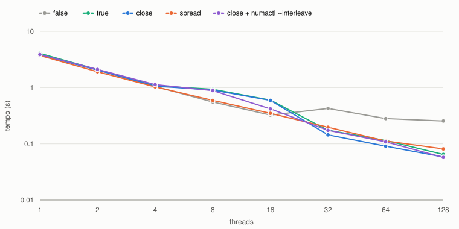

# Afinidade de threads no NPAD

## O que foi feito

Rodei o meu código de Navier-Stokes (a conta da Tarefa 11, com `schedule(static)`)
no **mesmo nó da Tarefa 12, o `r2n19`**, mudando só **onde as threads ficam**:

- **OpenMP** (slide 66): `OMP_PROC_BIND` = `false`, `true`, `close`, `spread` e
  `master`, com `OMP_PLACES=cores` (cada lugar é um núcleo físico);
- **sistema operacional**: `taskset` (escolhe quais CPUs o programa pode usar) e
  `numactl --interleave=all` (espalha a memória por todos os nós NUMA).

Para cada configuração o programa mostra **em qual CPU cada thread ficou**
(`sched_getcpu`) e mede o tempo com 1 a 128 threads.

**Resultado:** com poucas threads (8 e 16), `spread` foi **1,5 a 1,7×** mais rápido
que `close`. Com muitas, `close` foi melhor. `master` pôs todas as threads no mesmo
núcleo e ficou **26× mais lento que o código sequencial**.

## Conceitos

**Taxonomia de Flynn** (slides 59 a 62): classifica pelo número de fluxos de
instruções e de dados.

| classe | significado | exemplo |
|---|---|---|
| SISD | 1 instrução, 1 dado | processador sequencial simples |
| SIMD | 1 instrução, vários dados | vetorização (AVX), GPU |
| MISD | várias instruções, 1 dado | raro na prática |
| MIMD | várias instruções, vários dados | processador multicore, cluster |

O nó do NPAD é **MIMD de memória compartilhada**: cada núcleo executa as suas
instruções nos seus dados, e todos enxergam a mesma memória. E ele é **NUMA**
(slide 63): a memória está dividida em regiões, e cada região fica mais perto de
um grupo de núcleos.

**A máquina** (`lscpu`): 128 núcleos físicos, CPUs 0 a 127. As CPUs 128 a 255 são a
**segunda thread de hardware** dos mesmos núcleos (a CPU 128 é o núcleo 0). São
**8 nós NUMA** de 16 núcleos: o nó 0 tem os núcleos 0–15, o nó 1 tem 16–31, e
assim por diante. Cada grupo de 8 núcleos divide 32 MB de cache L3.

**Afinidade:** prender cada thread a um lugar da máquina, para o sistema não ficar
mudando ela de núcleo.

| `OMP_PROC_BIND` | o que faz |
|---|---|
| `false` | sem afinidade: o sistema operacional decide e pode mudar as threads de lugar |
| `true` | prende as threads, sem dizer como espalhar |
| `close` | threads em núcleos **vizinhos** da thread principal |
| `spread` | threads **espalhadas** pela máquina |
| `master` | todas no lugar da thread principal |

## Onde as threads ficaram (8 threads, medido)

| configuração | CPUs | o que isso quer dizer |
|---|---|---|
| `close` | 128, 1, 2, 3, 4, 5, 6, 7 | núcleos 0 a 7: vizinhos, mesmo nó NUMA, mesmo L3 |
| `true` | 0, 129, 130, 131, 132, 133, 134, 135 | núcleos 0 a 7: igual ao `close` |
| `spread` | 128, 16, 32, 48, 64, 80, 96, 112 | **um núcleo em cada nó NUMA** |
| `master` | 0, 128, 0, 0, 0, 128, 128, 128 | **todas no núcleo 0** |
| `false` | 237, 224, 66, 161, 112, 0, 46, 191 | espalhadas sem regra pelo sistema |
| `taskset -c 0-15` | 0, 15, 1, 14, 2, 13, 3, 12 | só dentro das CPUs 0 a 15, como mandado |
| `close` + `numactl` | 128, 129, …, 135 | núcleos 0 a 7, como o `close` |

> **Como eu explico:** o `close` coloca as threads lado a lado, no mesmo pedaço da
> máquina. O `spread` coloca cada uma num pedaço diferente. Eu não suponho isso:
> cada thread pergunta ao sistema em qual CPU está, e o programa imprime.

## Resultados

Malha 2048 × 2048, 200 passos, menor tempo de 5 execuções, nó `r2n19` exclusivo,
GCC 8.5.0, `-O2`. Tempo em segundos:

Tempo contra número de threads, escala log-log. O <code>master</code> fica de fora do gráfico porque sai da escala.

| threads | `close` | `spread` | `true` | `false` | `master` | `taskset` 0-15 | `close` + `numactl` |
|---:|---:|---:|---:|---:|---:|---:|---:|
| 1 | 3,79 | 3,71 | 4,05 | 3,96 | 3,95 | 3,77 | 3,87 |
| 4 | 1,06 | 1,03 | 1,08 | 1,04 | 5,21 | 1,07 | 1,13 |
| 8 | 0,902 | **0,591** | 0,931 | 0,554 | 8,41 | 0,655 | 0,883 |
| 16 | 0,591 | **0,348** | 0,597 | 0,324 | 11,28 | 0,584 | 0,418 |
| 32 | **0,144** | 0,197 | 0,175 | 0,425 | 24,07 | — | 0,174 |
| 64 | **0,091** | 0,112 | 0,114 | 0,281 | 49,64 | — | 0,108 |
| 128 | **0,058** | 0,081 | 0,065 | 0,254 | **103,89** | — | 0,057 |

## Análise

**1. Com 8 e 16 threads, `spread` ganha: 1,5× e 1,7×.** Com `close`, as 8 threads
ficam no mesmo grupo de núcleos: um cache de 32 MB e a memória de **um** nó NUMA
para todas. Com `spread`, cada thread fica num nó diferente: 8 caches e 8 ligações
com a memória. O problema tem 128 MB e é limitado por memória (Tarefa 12), então
mais cache e mais banda ajudam direto.

**2. Com 32 threads ou mais, `close` ganha.** Aí até o `close` já usa vários nós NUMA.
Uma explicação provável: com `close`, threads de números vizinhos ficam em núcleos
vizinhos, e no `schedule(static)` elas calculam linhas vizinhas da malha. As linhas
da fronteira entre os blocos, que as duas leem, ficam no mesmo cache. Com `spread`,
essas threads ficam longe. Não medi isso diretamente.

**3. `true` se comportou como `close`.** O mapa mostra os mesmos núcleos 0 a 7, e os
tempos são parecidos.

**4. `false` é instável.** Com 8 e 16 threads o sistema espalhou bem e foi tão bom
quanto `spread`. Mas com 32 ficou **mais lento** que com 16, e com 128 foi 4,4×
pior que `close`: sem afinidade, o sistema pode empilhar threads e mudá-las de
núcleo durante a execução.

**5. `master` é o pior caso.** Todas as threads no núcleo 0, revezando. Mais threads
só aumentam a fila: com 128 threads, 103,9 s, **26× mais lento que 1 thread**.

**6. Sistema operacional.** `taskset -c 0-15` prendeu o programa nas CPUs 0 a 15 (o
nó NUMA 0): com 16 threads deu o mesmo tempo do `close` (0,584 contra 0,591 s),
porque são os mesmos núcleos. `numactl --interleave=all` manteve as threads do
`close`, mas espalhou a **memória** por todos os nós: com 16 threads foi 1,4× mais
rápido que o `close` puro. É a mesma ideia do `spread`, só que aplicada à memória
em vez das threads.

> **Como eu explico:** com poucas threads, o `spread` ganha porque cada thread fica
> num pedaço diferente da máquina, com o seu cache e a sua ligação com a memória. No
> `close`, as 8 threads dividem um cache e uma memória só. Com muitas threads isso
> deixa de importar, porque todo mundo já está espalhado. E o `master` mostra o
> outro extremo: tudo num núcleo só, então mais threads só aumentam a fila.

## Conclusão

- A afinidade muda muito a escalabilidade: com 16 threads, de 0,35 s (`spread`) a
  11,3 s (`master`) para o **mesmo código**.
- **Poucas threads em código limitado por memória:** `spread`, para usar mais cache
  e mais memória.
- **Muitas threads:** `close` foi o melhor (0,058 s com 128), empatado com `close` + `numactl` (0,057 s).
- **Sem afinidade (`false`):** às vezes bom, às vezes ruim. Não dá para confiar.

## Código

{{CODIGO:afinidade.c}}
