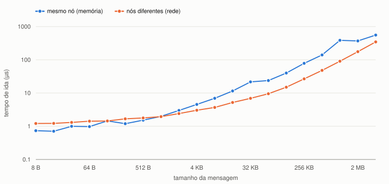
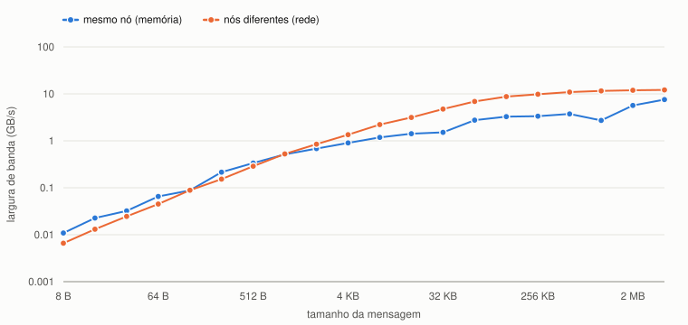

# Ping-pong MPI: latência e largura de banda

## O que foi feito

Programa MPI com **exatamente dois processos**. O processo 0 envia uma mensagem ao
processo 1, que devolve a mesma mensagem. Para cada tamanho, de **8 bytes a 4 MB**
(dobrando a cada passo), medi **1000 trocas seguidas** com `MPI_Wtime`.

Rodei em dois cenários no NPAD:

- **mesmo nó:** a mensagem passa pela memória do nó;
- **nós diferentes:** a mensagem passa pela rede do cluster. É o caso de memória
  distribuída de verdade.

## Conceitos

| termo | definição |
|---|---|
| MPI | processos independentes, **sem memória compartilhada**: só trocam dados por mensagens |
| rank | número de cada processo (`MPI_Comm_rank`): aqui, 0 ou 1 |
| `MPI_Send` / `MPI_Recv` | comunicação **ponto a ponto**, bloqueante |
| latência | custo fixo de cada mensagem, mesmo vazia |
| largura de banda | quantos bytes por segundo passam depois que a mensagem começou |

**Modelo:** tempo de uma mensagem ≈ **latência + tamanho / banda**.

- Mensagem pequena: o segundo termo é quase zero, então **a latência domina**.
- Mensagem grande: o segundo termo é muito maior, então **a banda domina**.

> **Como eu explico:** é como mandar uma encomenda. A latência é o tempo fixo de
> preparar e despachar, seja um envelope ou uma caixa. A banda é a velocidade do
> caminhão. Para um envelope, quase todo o tempo é despacho. Para uma mudança
> inteira, quase todo o tempo é transporte.

## Como funciona o código

| parte | o que faz |
|---|---|
| `MPI_Init`, `MPI_Comm_rank`, `MPI_Comm_size` | inicia o MPI e descobre quem é cada processo; confere se são 2 |
| `ida_e_volta` | processo 0: `Send` e depois `Recv`; processo 1: `Recv` e depois `Send` |
| troca de aquecimento | uma troca **fora** do cronômetro: a primeira inclui o custo de preparar a conexão |
| laço de 1000 trocas | medido com `MPI_Wtime`; 1000 repetições deixam o tempo grande o bastante para medir com precisão |
| tempo de ida | tempo total / (2 × 1000), porque cada troca é ida e volta |
| banda | bytes / tempo de ida |

> **Como eu explico:** a ordem é invertida de propósito. O processo 0 começa
> enviando e o 1 começa recebendo. Se os dois começassem com `Recv`, cada um ficaria
> esperando o outro para sempre: deadlock.

**Ambiente:** NPAD, partição `amd-512`, nós `r2n19` e `r2n20` exclusivos, GCC 8.5.0,
Open MPI 4.1.6, `-O2`. Cada processo fixo em um core (`--cpu-bind=cores`). Cada
cenário executado 3 vezes; os valores são a **mediana**.

## Resultados

Tempo de uma ida (µs) contra o tamanho da mensagem. Escala log-log.

Largura de banda (GB/s) contra o tamanho da mensagem. Escala log-log.

| tamanho | rede: ida (µs) | rede: ao dobrar | rede: GB/s | mesmo nó: ida (µs) | mesmo nó: GB/s |
|---:|---:|---:|---:|---:|---:|
| 8 B | 1,21 | — | 0,01 | 0,74 | 0,01 |
| 64 B | 1,42 | ×1,09 | 0,05 | 0,98 | 0,07 |
| 512 B | 1,77 | ×1,06 | 0,29 | 1,52 | 0,34 |
| 1 KB | 1,94 | ×1,10 | 0,53 | 1,99 | 0,51 |
| 4 KB | 3,03 | ×1,26 | 1,35 | 4,54 | 0,90 |
| 16 KB | 5,19 | ×1,41 | 3,15 | 11,53 | 1,42 |
| 64 KB | 9,52 | ×1,38 | 6,89 | 23,73 | 2,76 |
| 256 KB | 26,66 | ×1,78 | 9,83 | 78,19 | 3,35 |
| 1 MB | 90,45 | ×1,88 | 11,59 | 384,98 | 2,72 |
| 4 MB | 345,78 | ×1,97 | 12,13 | 554,98 | 7,56 |

"Ao dobrar" = quanto o tempo cresceu quando a mensagem dobrou de tamanho. A tabela
mostra tamanhos selecionados; os gráficos têm todos os 20.

## Os regimes (rede)

**1. Até ~1 KB: a latência domina.** A mensagem cresceu 128× (8 B → 1 KB) e o
tempo só foi de 1,2 para 1,9 µs. Dobrar o tamanho quase não muda o tempo (×1,0 a
×1,1). A latência da rede é de **~1,2 µs**.

**2. De ~2 KB a ~128 KB: transição.** As duas partes pesam. O tempo cresce, mas
menos que o tamanho (×1,2 a ×1,6).

**3. A partir de ~256 KB: a banda domina.** Dobrar o tamanho praticamente dobra o
tempo (×1,8 a ×1,97). A banda se aproxima do limite da rede: **~12,1 GB/s**.

**Ponto de equilíbrio:** latência × banda = 1,2 µs × 12,1 GB/s ≈ **14 KB**. Abaixo
disso, o custo fixo é maior que o de transmitir; acima, o contrário.

> **Como eu explico:** no gráfico de tempo, a curva começa quase deitada, isso é a
> latência dominando: o tamanho cresce e o tempo não. Depois ela vira uma reta
> subindo, isso é a banda dominando: dobrou a mensagem, dobrou o tempo. No gráfico
> de banda, mensagem pequena aproveita quase nada da rede, porque o custo fixo
> pesa mais. Só com mensagens grandes chego perto dos 12 GB/s.

## Mesmo nó contra rede

- **Mensagens pequenas: mesmo nó é mais rápido.** Latência de ~0,7 µs contra
  ~1,2 µs, porque a mensagem não passa pela placa de rede.
- **Mensagens grandes: a rede é mais rápida e mais estável.** No mesmo nó, a banda
  ficou entre ~2,7 e ~7,6 GB/s e variou entre as execuções (em 1 MB, de 2,3 a 6,2 GB/s).
  A explicação provável: dentro do nó, quem copia a mensagem é o **processador**,
  pela memória, e isso disputa cache e memória. Na rede, a **placa** copia direto da
  memória (RDMA), sem usar o processador.
- **O salto de 32 KB para 64 KB no mesmo nó:** o tempo quase não mudou (21,6 →
  23,7 µs) com o dobro de dados. Provavelmente o MPI muda de protocolo: mensagens
  pequenas passam por um buffer intermediário; as grandes são copiadas direto para o
  destino.

> **Como eu explico:** dentro do mesmo nó a latência é menor, porque não tem rede no
> meio. Mas para mensagem grande a rede ganhou, porque a placa de rede copia sozinha
> da memória, enquanto no mesmo nó quem copia é o próprio processador.

## Conclusão

- **Latência domina** até ~1 KB: o tempo fica perto de 1,2 µs (rede) ou 0,7 µs
  (mesmo nó), qualquer que seja o tamanho.
- **Banda domina** a partir de ~256 KB: o tempo cresce junto com o tamanho, e a rede
  chega a ~12 GB/s.
- **Consequência para programas paralelos:** mandar muitas mensagens pequenas é
  caro, porque cada uma paga a latência. É melhor juntar os dados em poucas
  mensagens grandes.

## Código

{{CODIGO:pingpong.c}}
