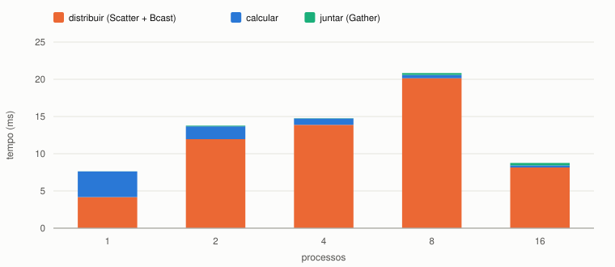
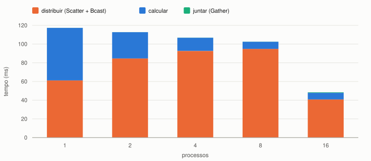

# Produto matriz-vetor com MPI

## O que foi feito

Programa MPI que calcula **y = A·x**, com A de tamanho M × N. A matriz é dividida
**por linhas** com `MPI_Scatter`, o vetor x vai **inteiro** para todos com
`MPI_Bcast`, cada processo calcula os elementos de y das suas linhas, e o processo 0
junta tudo com `MPI_Gather`.

Medi o tempo para matrizes 2048², 4096² e 8192² com 1, 2, 4, 8 e 16 processos.
Além do tempo total, medi **cada fase separada**: distribuir, calcular e juntar.

**Resultado:** o cálculo fica quase P vezes mais rápido, mas **distribuir a matriz
custa mais que calcular**, e por isso o tempo total quase não melhora.

## Conceitos

**Comunicação coletiva:** comunicação que envolve **todos os processos** de um
comunicador. Todos chamam a mesma função, na mesma ordem.

| função | o que faz | no programa |
|---|---|---|
| `MPI_Scatter` | a raiz **divide** um vetor em partes iguais, uma para cada processo | cada processo recebe M/P linhas de A |
| `MPI_Bcast` | a raiz manda **o mesmo dado** para todos | todos recebem x inteiro |
| `MPI_Gather` | o contrário do Scatter: a raiz **junta** as partes em ordem | o processo 0 monta y |
| `MPI_Barrier` | ninguém passa até todos chegarem | todos começam a medição juntos |

## Como funciona o código

| parte | o que faz |
|---|---|
| conferência | M precisa ser múltiplo do número de processos: o Scatter manda a mesma quantidade para cada um |
| `linhas = m / processos` | quantas linhas cada processo recebe |
| processo 0 | cria A e x (fora da medição) |
| `MPI_Scatter(a, linhas * n, ...)` | cada processo recebe `linhas × n` números: as suas linhas inteiras |
| `MPI_Bcast(x, n, ...)` | todos recebem os N elementos de x |
| laço `i`, `j` | `y_local[i]` = soma de `a_local[i][j] × x[j]` |
| `MPI_Gather(y_local, linhas, ...)` | o processo 0 recebe `linhas` resultados de cada processo, em ordem |
| `MPI_Wtime` | quatro marcas de tempo: antes de distribuir, depois de distribuir, depois de calcular, depois de juntar |

> **Como eu explico:** divido por linhas porque cada linha de A gera exatamente um
> elemento de y, sem depender das outras. E a matriz fica guardada linha por linha
> na memória, então as linhas de cada processo estão em sequência, e o Scatter só
> precisa cortar o vetor em pedaços iguais.

> **Como eu explico:** o x vai inteiro com Bcast porque toda linha precisa de todos
> os elementos de x. Não dá para dividir o x entre os processos como a matriz.

**Teste de correção:** M = 8, N = 3, x = 1. A linha 0 é 1, 2, 3, então y[0] = 6; a
linha 7 é 8, 9, 10, então y[7] = 27. Deu certo com 1, 2, 4 e 8 processos. Nas
medições, y[0] e y[M−1] também saíram iguais para qualquer número de processos.

**Ambiente:** NPAD, nó `r2n00` exclusivo, GCC 8.5.0, Open MPI 4.1.6, `-O2`, cada
processo fixo em um core. Cada configuração executada 5 vezes; os valores são a
**mediana**.

## Resultados

Tempo total (ms) e speedup T(1)/T(P):

| matriz | 1 | 2 | 4 | 8 | 16 | melhor speedup |
|---:|---:|---:|---:|---:|---:|---:|
| 2048² | **7,63** | 13,74 | 14,76 | 20,80 | 8,96 | nenhum (0,85) |
| 4096² | 30,19 | 37,97 | 33,96 | 31,38 | **17,36** | 1,74× |
| 8192² | 117,39 | 112,76 | 106,86 | 102,68 | **48,40** | 2,43× |

Matriz 2048²: tempo por fase (ms), mediana de 5 execuções.

Matriz 8192²: tempo por fase (ms), mediana de 5 execuções.

| matriz | processos | distribuir | calcular | juntar | distribuir / total |
|---:|---:|---:|---:|---:|---:|
| 2048² | 1 | 4,17 | 3,45 | 0,01 | 55% |
| 2048² | 8 | 20,15 | 0,44 | 0,25 | 97% |
| 8192² | 1 | 61,19 | 56,17 | 0,04 | 52% |
| 8192² | 8 | 94,87 | 7,61 | 0,12 | 92% |
| 8192² | 16 | 40,79 | 7,09 | 0,55 | 84% |

## Análise

**1. O cálculo escala quase perfeitamente.** Cada processo faz 1/P das linhas. Com 8
processos, o cálculo ficou 7,4 a 7,8× mais rápido. Em 8192², de 8 para 16 processos
ele parou de cair (7,6 → 7,1 ms). Provavelmente os 16 processos ficaram na mesma
região de memória e dividiram a mesma banda, como na Tarefa 12 (não verifiquei).

**2. Distribuir custa mais que calcular: razão computação/comunicação.** Cada
elemento de A é usado em **uma só conta** (uma multiplicação e uma soma), mas
precisa ser **enviado** (8 bytes). Mesmo com 1 processo, quando o Scatter é só uma
cópia local, distribuir já leva mais tempo que calcular (4,17 contra 3,45 ms em
2048²). Com mais processos, a cópia vira mensagem entre processos, que é mais lenta
(Tarefa 14: ~3 a 7 GB/s no mesmo nó).

**3. A distribuição não diminui com mais processos.** O processo 0 precisa enviar a
matriz inteira de qualquer jeito. Até 8 processos ela até cresce (2048²: 4,17 →
20,15 ms). Funciona como a parte serial da lei de Amdahl: limita o speedup, por mais
que o cálculo acelere.

**4. Com 16 processos a distribuição caiu pela metade.** Não medi o motivo. A
hipótese é que o Open MPI escolhe o algoritmo do Scatter conforme o número de
processos: com 16 ele pode usar uma árvore, em que processos intermediários repassam
partes e vários envios acontecem ao mesmo tempo. Foi o único caso com ganho real:
2,43× em 8192².

**5. Juntar é barato.** O Gather move só M números (o vetor y), contra M × N do
Scatter.

> **Como eu explico:** o cálculo ficou quase P vezes mais rápido, mas quase todo o
> tempo vai em distribuir a matriz. Cada número de A é usado numa conta só, então
> mandar ele custa mais do que fazer a conta. E quem manda tudo é o processo 0
> sozinho, então essa parte não diminui com mais processos, como a parte serial da
> lei de Amdahl.

## Conclusão

- **Cálculo:** escala bem, quase P vezes mais rápido.
- **Total:** quase não melhora, porque a distribuição de A domina (52% a 97% do
  tempo). Só houve ganho real com 16 processos nas matrizes maiores (até 2,43×).
- **Como melhoraria:** se cada processo já tivesse as suas linhas (gerando ou lendo
  do disco), só o x precisaria ser enviado, e o tempo seria quase só o cálculo.

## Código

{{CODIGO:matriz_vetor_mpi.c}}
